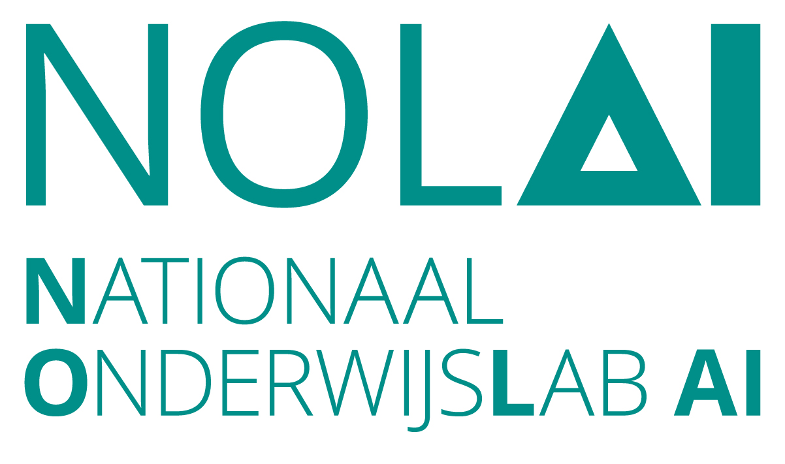

# Wachtrijker - Efficiënter wachten op de leraar

<p align="center">
  <a href="https://ta-help.me/">
    
  </a>
  &nbsp;&nbsp;
  <a href="https://www.tue.nl/">
    
  </a>
  &nbsp;&nbsp;
  <a href="https://www.hetstedelijk.nl/">
    
  </a>
  &nbsp;&nbsp;
  <a href="https://www.ru.nl/onderzoek/onderzoeksprojecten/efficienter-wachten-op-de-leraar">
    
  </a>
</p>

> Dit project is medegefinancierd door het Nationaal Onderwijslab AI (NOLAI).

**Wachtrijker** is een Django-webapp die studenten helpt om een goede vraag te formuleren
*voordat* deze wordt doorgestuurd naar een student-assistent of docent.

Een student chat met een bot. Na elk bericht wordt het hele gesprek samengevat en beoordeeld
op vijf rubriekcategorieën:

| Categorie | Wat het controleert |
| --- | --- |
| `context` | Is er voldoende achtergrond gegeven? |
| `problem` | Is het specifieke probleem duidelijk verwoord? |
| `goal` | Is het duidelijk wat de student wil bereiken? |
| `attempts` | Heeft de student beschreven wat er al is geprobeerd? |
| `terminology` | Wordt de juiste vakterminologie gebruikt? |

De beoordeling gebruikt een combinatie van gefinetunede **BERT**-classifiers en een
LLM op basis van **Azure OpenAI**. De bot blijft gerichte feedback geven op de zwakste categorie
totdat elke categorie hoog genoeg scoort, waarna de vraag als *compleet* wordt gemarkeerd en klaar
is om door te sturen.

## Vereisten

- Python **3.12+**
- [uv](https://docs.astral.sh/uv/) voor het beheer van Python-dependencies
- [Node.js / npm](https://nodejs.org/) (Bootstrap 5 en jQuery worden geserveerd vanuit `node_modules`)

## Het project draaien (zonder modellen, zonder LLM)

De app wordt geleverd met een **dummy-modus** zodat je hem kunt draaien en verkennen zonder
BERT-weights te downloaden of een OpenAI-endpoint te configureren. In de dummy-modus worden de
classifiers, de samenvatter en de feedbackgenerator vervangen door eenvoudige stand-ins.

De dummy-modus wordt bepaald door één enkele instelling in `wachtrijker/settings.py`:

```python
DUMMY_CLASSIFIERS = True   # standaard — geen torch-weights of LLM vereist
```

Om de app te starten:

```bash
# 1. Installeer de Python-dependencies
uv sync

# 2. Installeer de JS-dependencies (Bootstrap / jQuery)
npm install

# 3. Voer de databasemigraties uit (gebruikt standaard SQLite)
uv run python manage.py migrate

# 4. Start de dev-server
uv run python manage.py runserver
```

Open vervolgens http://127.0.0.1:8000/ en begin met chatten. In de dummy-modus geeft de bot
standaardfeedback en scores op basis van berichtlengte, genoeg om de hele flow door te klikken.

## De classifier-modellen trainen

De classifiers worden vanaf BERT gefinetuned op CSV's met gelabelde vragen. Elke CSV heeft een
`text`-kolom plus één kolom per rubriekcategorie (`context`, `problem`, `goal`, `attempts`,
`terminology`) met scores van 1–5.

Een (gegenereerde) voorbeelddataset is beschikbaar in [`data/example_data.csv`](data/example_data.csv).

```bash
# Train de productie-classifiers
# Schrijft naar settings.MODEL_DIR (standaard de map ./weights)
uv run python manage.py train_classifier <input.csv> [-o <output_dir>] [-c <column>] [-b <batch_size>] [-e <max_epochs>] [-l <lr>]

# Draai de predictor op willekeurige tekst
uv run python manage.py predict -t "een vraag" [-c <column>] [-o <model_dir>]
```

Zodra je echte gewichten hebt getraind, zet je de dummy-modus uit om ze te gebruiken:

```python
# wachtrijker/settings.py
DUMMY_CLASSIFIERS = False
```

Hiervoor moet ook een OpenAI-endpoint zijn gedefinieerd zoals hieronder beschreven. De productie-classifiers worden één keer geladen bij het starten van de server.

## Het OpenAI-endpoint (Azure) inschakelen

De samenvatter en de feedbackgenerator roepen een Azure OpenAI
chat-completions-deployment aan. Het endpoint wordt geconfigureerd in `wachtrijker/settings.py`:

Pas `OPENAI_BASE`, `OPENAI_MODEL`, `OPENAI_VERSION` en `OPENAI_KEY` aan zodat ze overeenkomen met je eigen
Azure OpenAI-resource en -deployment.

## De tests draaien

De tests staan onder `wachtrijker/tests/` en gebruiken de ingebouwde testrunner van Django:

```bash
# Draai de hele suite
uv run python manage.py test
```

De tests mocken externe aanroepen (ze gebruiken `SimpleTestCase` en benaderen het echte
OpenAI-endpoint niet en vereisen geen getrainde gewichten).

## Linten en formatteren

Formatteren en linten worden afgedwongen via [ruff](https://docs.astral.sh/ruff/),
[black](https://black.readthedocs.io/) en pre-commit:

```bash
# Draai alle pre-commit-hooks
uv run pre-commit run --all-files

# Of draai de tools rechtstreeks
uv run ruff check --fix .
uv run black .
```
